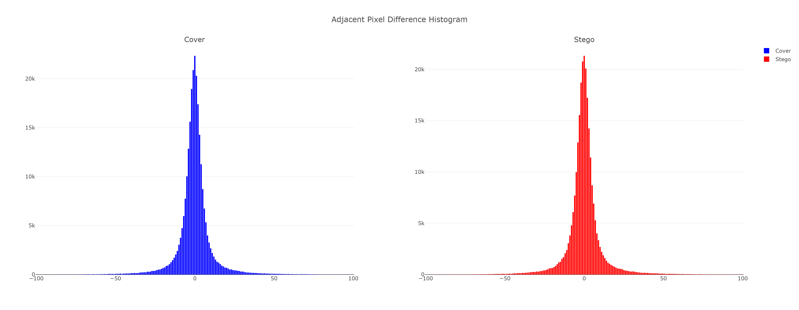
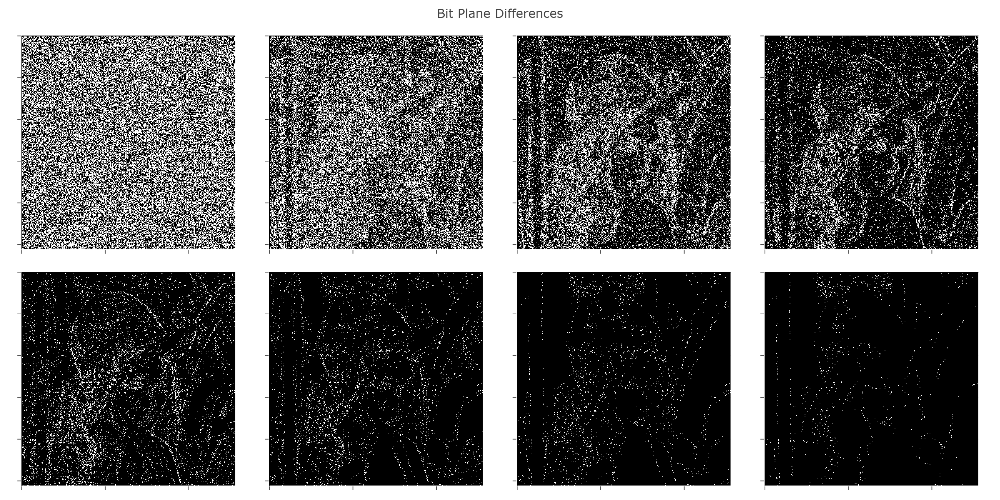
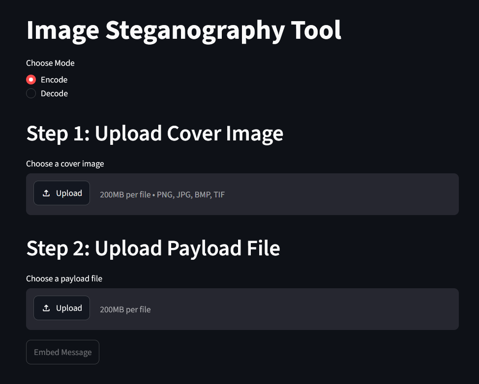

# Image Steganography Using Pixel Characteristics

A Python implementation of the image steganography method proposed by Park et al., featuring secret message encoding and decoding, image quality analysis, and an interactive Streamlit application.

## Overview

Image steganography hides information within a digital image so that the embedded message is not readily noticeable.

This project implements the method described in *An Image Steganography Using Pixel Characteristics* by Young-Ran Park, Hyun-Ho Kang, Sang-Uk Shin, and Ki-Ryong Kwon. The implementation explores the method's practical behavior through visual comparisons and quantitative image quality analysis.

The project also provides a Streamlit interface for experimenting with message embedding and extraction.

## Features

- **Message encoding:** Embed a secret message or payload into a cover image.
- **Message decoding:** Extract the embedded payload from a stego image.
- **Image comparison:** Compare cover and stego images visually.
- **Image quality evaluation:** Calculate Peak Signal-to-Noise Ratio (PSNR).
- **Histogram analysis:** Compare pixel intensity distributions.
- **Bit-plane analysis:** Visualize bit planes and differences between images.
- **Interactive interface:** Perform encoding, decoding, and analysis through a Streamlit application.

## Algorithm Overview

The proposed method uses pixel characteristics to determine how much secret information can be embedded in an image.

The number of bits embedded in a pixel depends on the difference between adjacent pixels. This allows the embedding capacity to adapt to local image characteristics: smooth regions and edge regions can accommodate different amounts of information.

The general workflow is:

1. **Input:** Select a cover image and provide the secret payload.
2. **Embedding:** Apply the paper's pixel-characteristics-based embedding procedure to produce a stego image.
3. **Extraction:** Recover the hidden payload from the stego image using the corresponding decoding procedure.
4. **Evaluation:** Compare the original and stego images using visual inspection and image quality metrics.

The objective is to investigate the trade-off between embedding capacity and the visual quality of the resulting image.

For the precise embedding rules and mathematical details, refer to the original publication cited below.

## Results and Analysis

This section presents experimental results produced by this implementation. Results reproduced from the original paper should be identified separately from additional experiments.

### 1. Cover Image vs. Stego Image

The cover image is the original image before embedding. The stego image is the resulting image after embedding the secret payload.

| Cover image | Stego image |
|---|---|
|  |  |

**Observation:** There are no visible differences between the two images. Embedding does not introduce noticeable visual artifacts.

### 2. Histogram Comparison

Unlike a conventional intensity histogram, this visualization shows the distribution of differences between consecutive pixel values in the cover and stego images.



**Observation:** The histogram of the stego image is very similar to the histogram of the cover image. That shows that the method is secure against attacks in image processing.

### 3. Bit-Plane Analysis

Each pixel value can be represented in binary, with each bit position forming a separate bit-plane. This image shows difference between the bit-planes of cover image and the bit-planes of stego image.
The bit-plane visualizations are presented in order from LSB to MSB.



**Observation:** This shows that the algorithm embeds more bits into the edge areas than the smooth areas.
The LSB plane shows the most changes because the algorithm embeds secret bits by adjusting pixel values to match the message while minimizing the difference from the original values. Higher-order bit-planes generally preserve more of the original image structure.

### 4. Quantitative Evaluation

Peak Signal-to-Noise Ratio (PSNR) measures the pixel-wise reconstruction error between the cover image and the stego image. A higher PSNR generally indicates lower pixel-wise distortion.

| Metric | Result |
|---|---|
| Cover image dimensions | 512x512 |
| Embedded payload size (bytes) | 61712 |
| PSNR (dB) | 40.58 |

PSNR is an image fidelity metric, not a direct measure of steganographic security. Histogram and bit-plane comparisons are also exploratory analyses rather than proof that a method is undetectable.

## Streamlit Application

The project includes an interactive web application for encoding and decoding payloads and inspecting image characteristics.

**Live demo:** [Try the application](https://image-steganography-pxchar.streamlit.app)



## Installation

Clone the repository:

```bash
git clone https://github.com/jezte/image-steganography
cd image-steganography
```

Create and activate a virtual environment.

**Windows PowerShell:**

```powershell
python -m venv .venv
.\.venv\Scripts\Activate.ps1
```

Install the project dependencies:

```bash
pip install -r requirements.txt
```

## Run Locally

Launch the Streamlit application:

```bash
streamlit run app.py
```

## Technologies

- Python
- NumPy
- Plotly
- Pillow
- Streamlit

## Reference

Park, Y.-R., Kang, H.-H., Shin, S.-U., & Kwon, K.-R. (2005). *An Image Steganography Using Pixel Characteristics.* In **Computational Intelligence and Security**, Lecture Notes in Computer Science, vol. 3802, pp. 581–588. Springer.

The algorithm implemented in this repository is based on the cited publication. This repository is an independent implementation and is not an official implementation by the paper's authors.
